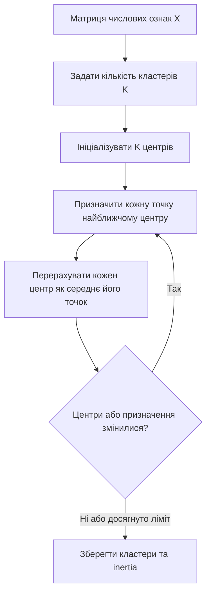
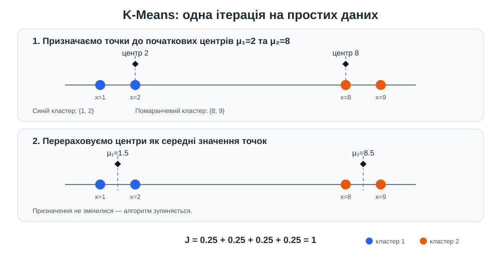
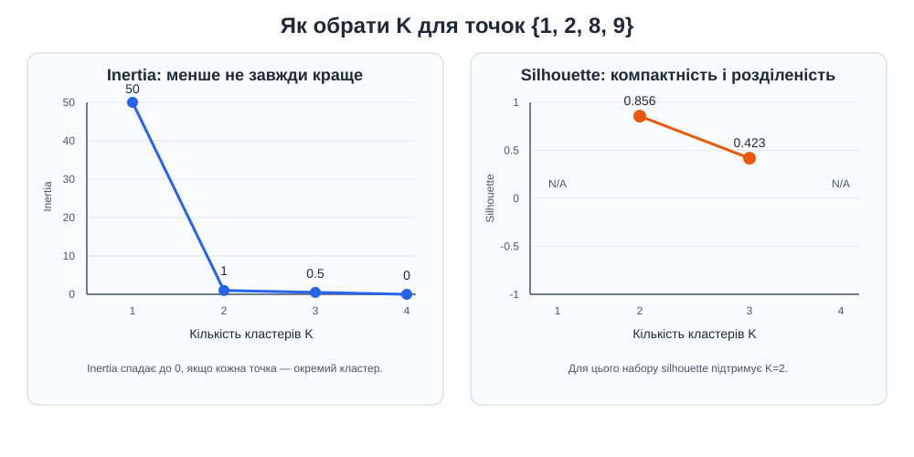
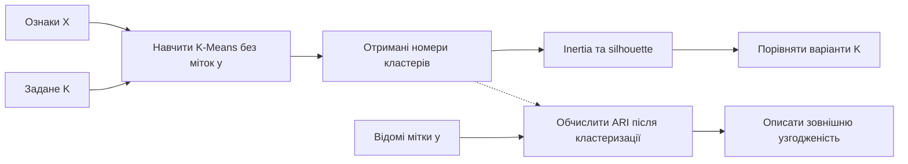
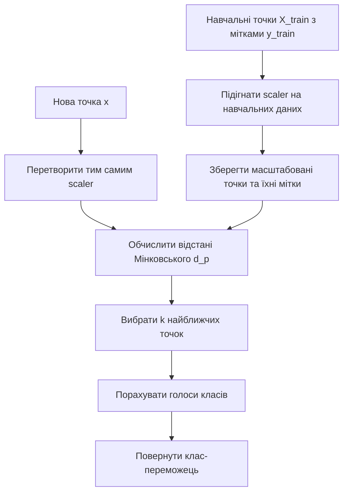
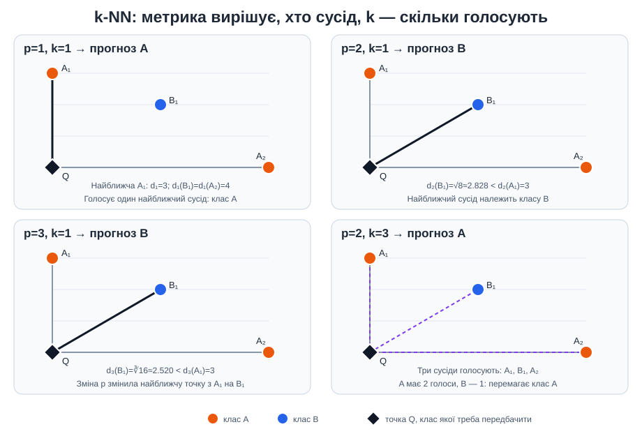
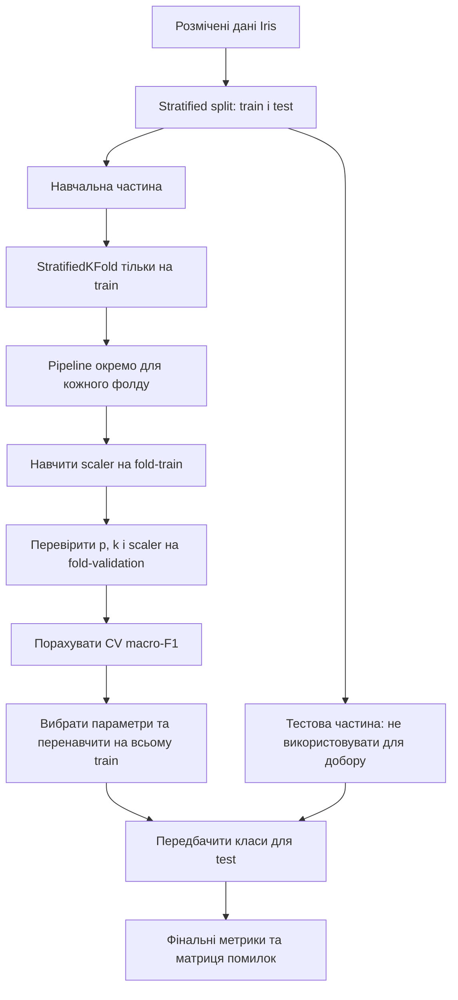

# Лабораторна робота № 2
## Кластеризація K-Means та класифікація k-NN на наборі Iris

### Мета роботи

Навчитися розрізняти навчання без учителя та з учителем; дослідити K-Means і k-NN на тих самих ознаках Iris; перевірити вплив масштабування та відстані Мінковського; коректно оцінювати кластеризацію і класифікацію.

Ця робота продовжує Lab1: норми L1, L2 та L3 стають відстанями між спостереженнями, а масштабування ознак впливає вже на реальне групування та передбачення класу.

### Програмне забезпечення

- Стабільна версія Python, новіша за 3.13. Alpha-, beta- та release-candidate версії не підходять.
- NumPy — масиви й ручне обчислення відстані Мінковського.
- scikit-learn — набір Iris, масштабування, K-Means, k-NN, крос-валідація та метрики.
- Matplotlib — графіки кластерів і меж рішень.
- pytest — автоматизовані перевірки.

### Структура проєкту

- `main.py` — короткий приклад K-Means і k-NN без добору параметрів.
- `student_template.py` — завдання з послідовними позначками `TODO`.
- `solution.py` — еталонне виконання для самоперевірки.
- `images/` — SVG-ілюстрації алгоритмів і ручних прикладів.
- `tests/conftest.py` — спільні дані та незалежні еталонні обчислення.
- `tests/test_implementation.py` — тести еталонного рішення.
- `tests/test_template.py` — короткий тест першої функції студента.
- `tests/test_student_implementation.py` — заготовки тестів, які студент має доповнити.
- `requirements.txt` — залежності роботи.
- `requirements-dev.txt` — залежності разом із pytest.

### Підготовка та запуск

Відкрийте папку `Lab2` у VS Code та виконуйте команди з PowerShell у цій папці.

1. Перевірте доступні інтерпретатори:

```powershell
py -0p
```

Створіть `.venv-stable` на основі стабільної версії Python, новішої за 3.13. Якщо користуєтеся UV:

```powershell
uv python install 3
$pythonPath = uv python find 3
& $pythonPath -c "import sys; assert sys.version_info > (3, 13), 'Потрібен стабільний Python новіший за 3.13'; print(sys.version)"
& $pythonPath -m venv .venv-stable
```

Без UV підставте шлях до потрібного `python.exe` зі списку `py -0p`:

```powershell
& "<шлях до стабільного python.exe>" -m venv .venv-stable
```

Якщо `.venv-stable` уже існує, перевірте її версію замість повторного створення. Не використовуйте alpha-, beta- або release-candidate інтерпретатор.

2. Установіть залежності:

```powershell
.\.venv-stable\Scripts\python.exe --version
.\.venv-stable\Scripts\python.exe -m pip install --upgrade pip
.\.venv-stable\Scripts\python.exe -m pip install -r requirements-dev.txt
```

3. Перевірте приклад і тести:

```powershell
.\.venv-stable\Scripts\python.exe main.py
.\.venv-stable\Scripts\python.exe -m pytest --collect-only -q
.\.venv-stable\Scripts\python.exe -m pytest tests/test_implementation.py -v
```

У VS Code виберіть `.venv-stable` через **Ctrl+Shift+P → Python: Select Interpreter**.

### Порядок виконання

1. Запустіть `main.py` без змін і зверніть увагу, що K-Means не отримує міток видів, а k-NN навчається за мітками.
2. Скопіюйте шаблон у файл власної реалізації:

```powershell
Copy-Item student_template.py student_implementation.py
```

3. Виконайте TODO 1 і перевірте відстань Мінковського:

```powershell
.\.venv-stable\Scripts\python.exe -m pytest tests/test_template.py -v
```

4. Реалізуйте TODO 1–8 у `student_implementation.py`. Не змінюйте `solution.py`, `tests/test_implementation.py` та спільні фікстури.
5. Допишіть assertions у `tests/test_student_implementation.py`. Очікувані числові значення беріть із фікстур, а не копіюйте у тести.
6. Запустіть студентські й еталонні тести:

```powershell
.\.venv-stable\Scripts\python.exe -m pytest tests/test_student_implementation.py -v
.\.venv-stable\Scripts\python.exe -m pytest -v
```

7. Після завершення TODO запустіть власну програму. Прапорець `--plot` показує три графіки:

```powershell
.\.venv-stable\Scripts\python.exe student_implementation.py
.\.venv-stable\Scripts\python.exe student_implementation.py --plot
```

До завершення TODO програма може зупинятися з `NotImplementedError`. Перед здаванням повний набір pytest має пройти без помилок і пропущених студентських тестів.

### Теоретичні відомості

#### 1. Дані, ознаки та відстані

Набір даних можна подати матрицею ознак `X ∈ R^(n×d)`, де `n` — кількість спостережень, а `d` — кількість ознак. Рядок `x_i` описує одне спостереження; стовпець — одну вимірювану властивість. Для Iris у цій лабораторній `d=2`: довжина й ширина пелюстки. Мітка `y_i` — відомий вид квітки; K-Means її не отримує, а k-NN використовує під час навчання.

Відстань вимірює, наскільки два спостереження відрізняються в просторі ознак. Відстань Мінковського між векторами `x` та `z`:

$$
d_p(x,z)=\left(\sum_{j=1}^{d}|x_j-z_j|^p\right)^{1/p},\qquad p\geq1.
$$

- `p=1` — Manhattan-відстань, або L1: сума абсолютних різниць координат.
- `p=2` — евклідова відстань, або L2: звична пряма відстань між точками.
- `p=3` — відстань Мінковського третього порядку, або L3.

Наприклад, відстань від `(3, -4, 12)` до нульового вектора для `p=1` дорівнює `19`, а для `p=2` — `13`. Для більшого `p` великі різниці окремих координат мають сильніший вплив на результат. Значення `p` змінює геометрію сусідства, а отже може змінити і сусідів, і передбачений k-NN клас.

За `p≥1` відстань Мінковського є метрикою: вона невід'ємна, симетрична, дорівнює нулю для однакових точок і задовольняє нерівність трикутника. Сам алгоритм K-Means у цій роботі використовує не всі варіанти `p`: стандартний K-Means у scikit-learn спирається на евклідову геометрію та мінімізує **квадрати** евклідових відстаней. `p` у лабораторній змінюється для k-NN, але не для K-Means.

Відстань має сенс лише разом із визначенням ознак та їхніх одиниць. Якщо довжина задана в сантиметрах, а інша ознака — у міліметрах, друга може домінувати лише через одиницю вимірювання. До відстаневих методів зазвичай застосовують масштабування, а його параметри навчають тільки на даних, дозволених для навчання.

#### 2. K-Means: кластеризація без учителя

**Кластеризація** групує спостереження за подібністю, коли справжні класи не передаються алгоритму. K-Means шукає `K` груп і по одному центроїду `μ_k` для кожної. Центроїд — середнє координат усіх точок, віднесених до відповідного кластера; він не обов'язково збігається з реальним спостереженням.

Якщо `C_k` — набір точок кластера `k`, K-Means мінімізує суму квадратів відстаней від точок до їхніх центрів:

$$
J(C_1,\ldots,C_K,\mu_1,\ldots,\mu_K)
=\sum_{k=1}^{K}\sum_{x_i\in C_k}\lVert x_i-\mu_k\rVert_2^2.
$$

Це значення називають **inertia** або within-cluster sum of squares. Менша inertia означає, що точки ближче до призначених центроїдів, але сама по собі не доводить, що знайдено «правильні» чи природні групи.

##### Ітерації алгоритму

Класичний алгоритм Lloyd виконує такі кроки:

1. Вибрати `K` початкових центрів.
2. Для кожної точки знайти найближчий центр і призначити точку його кластеру.
3. Перерахувати кожний центр як середнє координат точок його кластера.
4. Повторювати кроки призначення та перерахунку, доки призначення перестануть змінюватися або зміщення центрів стане достатньо малим.
5. Зупинити роботу також можна після досягнення ліміту ітерацій.

На кожній ітерації сума квадратів відстаней не зростає. Проте цільова функція не є опуклою щодо одночасного вибору призначень і центрів: результат може залежати від початкових точок, а алгоритм знаходить локальний, не обов'язково глобальний мінімум.

Схема показує повторюваний цикл призначення точок і оновлення центрів:



##### Ініціалізація, повторні запуски та параметри

Погані початкові центри можуть привести до слабкого результату. Ініціалізація **k-means++** розміщує початкові центри так, щоб точки, далекі від уже вибраних центрів, мали більшу ймовірність бути обраними. Це зазвичай дає кращий старт, але не усуває локальні мінімуми.

scikit-learn може запускати алгоритм кілька разів із різними ініціалізаціями й залишати результат із найменшою inertia. У цьому проєкті `n_init=20` задає кількість таких запусків, а `random_state=7` робить випадкову ініціалізацію відтворюваною. Інші важливі параметри:

- `n_clusters` — кількість кластерів `K`, яку потрібно задати наперед;
- `init` — спосіб вибору початкових центрів;
- `max_iter` — найбільша кількість ітерацій одного запуску;
- `tol` — поріг зміни центрів для зупинки;
- `n_init` — кількість незалежних ініціалізацій.

`KMeans.fit_predict(X)` навчає центри й повертає номер найближчого кластера для кожного рядка `X`. Номери `0`, `1`, `2` — **ідентифікатори**, а не значення семантичних класів. Наприклад, два запуски можуть поміняти номери кластерів місцями, не змінивши самого групування.

##### Мініприклад K-Means: призначення точок і цільова функція

Розгляньмо чотири точки на одній числовій осі:

```text
значення x:   1   2                         8   9
точки:        ●   ●                         ●   ●
```

Для `K=2` візьмімо початкові центри `μ₁=2` та `μ₂=8`. Це проста вдала ініціалізація для ручного розрахунку:

| Точка `x` | Відстань до `μ₁=2` | Відстань до `μ₂=8` | Кластер |
|---:|---:|---:|---|
| 1 | 1 | 7 | 1 |
| 2 | 0 | 6 | 1 |
| 8 | 6 | 0 | 2 |
| 9 | 7 | 1 | 2 |

Тепер перерахуймо центри як середні значення точок кожного кластера:

$$
\mu_1=\frac{1+2}{2}=1.5,\qquad
\mu_2=\frac{8+9}{2}=8.5.
$$

Нові центри не змінюють призначення точок, тому цей приклад уже зійшовся. Значення цільової функції — сума **квадратів** відстаней:

$$
J=(1-1.5)^2+(2-1.5)^2+(8-8.5)^2+(9-8.5)^2
=0.25+0.25+0.25+0.25=1.
$$

Отже, K-Means не просто шукає «близькі точки»: він повторює призначення та перерахунок середніх, щоб зменшити `J`. Якщо почати з інших центрів, проміжні призначення можуть бути іншими, а інколи алгоритм зупиниться в гіршому локальному мінімумі. Тому використовують k-means++ і кілька запусків.

Для цих точок k-means++ ілюструє ймовірнісний вибір: якщо перший центр `2`, квадрати відстаней до нього для точок `1, 2, 8, 9` дорівнюють `1, 0, 36, 49`. Другий центр вибирається з імовірністю, пропорційною цим числам. Точка `9` у цьому прикладі має більшу ймовірність бути вибраною, ніж `8`, але вибір не є гарантованим.



##### Вибір числа кластерів

`K` — один із головних параметрів K-Means. Надто мале `K` об'єднує різні групи; надто велике може розділити одну групу на кілька частин. Універсального правила, яке завжди знаходить єдине правильне `K`, немає.

- **Elbow method (метод ліктя):** побудувати графік inertia для різних `K` і шукати ділянку, після якої збільшення `K` дає значно менше зменшення inertia. «Лікоть» може бути нечітким.
- **Silhouette:** оцінити, наскільки точки компактні у своїх кластерах і віддалені від інших.
- **Предметна інтерпретація:** перевірити, чи має поділ практичний сенс, а не лише добру числову оцінку.

Inertia не можна використовувати ізольовано для порівняння моделей з різними `K`: додавання центрів майже завжди не збільшує її, а при `K=n` кожна точка може стати окремим кластером з нульовою inertia. Тому зменшення inertia саме по собі не є доказом якості розбиття.

##### Silhouette — внутрішня оцінка

Silhouette не потребує справжніх міток класів. Для точки `i`:

- `a(i)` — середня відстань до інших точок її кластера;
- `b(i)` — найменша середня відстань до точок будь-якого іншого кластера.

Оцінка точки:

$$
s(i)=\frac{b(i)-a(i)}{\max(a(i),b(i))}.
$$

Середнє `s(i)` для всіх точок — загальний silhouette score. Значення близьке до `1` зазвичай відповідає компактному й відокремленому кластеру; близьке до `0` — точці біля межі; від'ємне — точці, якій може бути ближчим інший кластер. Значення лежить у діапазоні від `-1` до `1`; вище не завжди означає корисніший поділ для будь-якого застосування.

Для silhouette потрібно від 2 до `n_samples - 1` різних кластерів. Оцінювати його слід у тому самому просторі ознак і з тією самою метрикою, які відповідають виконаному групуванню. У цій роботі ознаки спочатку масштабуються, тому silhouette для K-Means обчислюється на масштабованій матриці.

##### Ручний приклад silhouette та вибору `K`

Для точок `1, 2, 8, 9` припустімо поділ `C₁={1,2}`, `C₂={8,9}`. Для точки `1`:

- її середня відстань до інших точок свого кластера: `a(1)=|1-2|=1`;
- середня відстань до кластера `{8,9}`: `( |1-8| + |1-9| ) / 2 = (7+8)/2 = 7.5`;
- найближчий інший кластер — `{8,9}`, отже `b(1)=7.5`.

Тому:

$$
s(1)=\frac{7.5-1}{\max(7.5,1)}
=\frac{6.5}{7.5}\approx0.867.
$$

Для точки `2`: `a(2)=1`, `b(2)=(6+7)/2=6.5`, тому `s(2)=5.5/6.5≈0.846`. Точки `8` і `9` симетричні до `2` і `1`. Середній silhouette для `K=2`:

$$
\frac{0.867+0.846+0.846+0.867}{4}\approx0.856.
$$

На тих самих точках можна побачити, чому не варто обирати `K` тільки за inertia:

| `K` | Один оптимальний поділ | Inertia `J` | Середній silhouette |
|---:|---|---:|---:|
| 1 | `{1,2,8,9}` | 50 | Не визначений: потрібні щонайменше 2 кластери |
| 2 | `{1,2}`, `{8,9}` | 1 | Приблизно 0.856 |
| 3 | `{1,2}`, `{8}`, `{9}` | 0.5 | Приблизно 0.423 |
| 4 | `{1}`, `{2}`, `{8}`, `{9}` | 0 | Не визначений: кожна точка стала окремим кластером |

Для кластерів з однією точкою scikit-learn задає silhouette точки рівним `0`; саме тому середня оцінка для `K=3` тут нижча. Inertia зменшується від `50` до `0` зі збільшенням `K`, але `K=4` не дає змістовного групування. Для цього штучно простого набору silhouette підтримує `K=2`. У реальних даних оцінку потрібно доповнювати предметним змістом.



##### ARI — зовнішнє порівняння з відомими мітками

Adjusted Rand index (ARI) порівнює два розбиття за тим, які пари спостережень опинилися разом або окремо, та коригує узгодженість на випадковий збіг:

$$
\operatorname{ARI}=
\frac{\operatorname{RI}-\mathbb{E}[\operatorname{RI}]}
{\max(\operatorname{RI})-\mathbb{E}[\operatorname{RI}]}.
$$

`ARI=1` означає однакові розбиття, значення біля `0` — узгодженість на рівні випадкового поділу, від'ємне значення — гіршу за випадкову узгодженість. ARI не залежить від конкретних номерів кластерів: перестановка `0`, `1`, `2` не змінює результат.

У навчальній задачі K-Means навчається лише на ознаках. Види Iris можна передати в ARI **після** кластеризації як зовнішню довідкову оцінку. Якщо використовувати ARI для вибору `K` або параметрів, відомі мітки вже впливатимуть на процес, який мав бути без учителя; у звіті це треба було б називати іншим експериментом.

Схема підкреслює, що silhouette та inertia використовуються для аналізу структури кластерів, а справжні мітки потрапляють лише до окремого постфактум-обчислення ARI:



##### Ручний приклад ARI та довільних номерів кластерів

Нехай справжні класи чотирьох точок `1, 2, 8, 9` такі: `A, A, B, B`. Якщо K-Means повернув номери кластерів `7, 7, 3, 3`, розбиття збігається зі справжнім, хоча номери кластерів не збігаються з назвами класів. Тут `ARI=1`. Перейменування номерів, наприклад на `3, 3, 7, 7`, також залишить `ARI=1`.

Для контрасту, якщо номери кластерів `0, 1, 0, 1`, таблиця перетину буде такою:

| Справжній клас | Кластер 0 | Кластер 1 |
|---|---:|---:|
| A | 1 | 1 |
| B | 1 | 1 |

Жодна пара точок одного справжнього класу не залишилася разом у кластері, тому для цього прикладу `ARI=-0.5` — гірше за випадкове узгодження. Практичний висновок: ARI оцінює **збіг розбиттів**, а не збіг числових кодів міток.

##### Припущення, сильні сторони й обмеження K-Means

K-Means особливо доречний, коли:

- ознаки числові, а відстань між точками має практичний сенс;
- групи приблизно компактні, опуклі та подібні за розміром і розкидом;
- потрібно швидко розбити багато спостережень на задану кількість груп;
- потрібні прості центри, які можна інтерпретувати як середні профілі кластерів.

Його обмеження:

- `K` треба задати наперед;
- результат чутливий до масштабування, початкових центрів та одиничних викидів: середнє зміщується через екстремальні значення;
- алгоритм погано відтворює не сферичні, вкладені або різнорозмірні групи, а також групи різної щільності;
- кластери задаються найближчими центрами, тому межі утворюють області Вороного; складні нелінійні форми таке розбиття не описує;
- стандартний K-Means призначений для числових ознак і евклідової геометрії; категоріальні дані не можна просто кодувати довільними числами й трактувати як звичайні координати;
- у великій кількості вимірів відстані можуть ставати менш інформативними, а шумові чи нерелевантні ознаки — спотворювати центри.

Обчислювальна вартість одного набору ітерацій приблизно пропорційна `n × K × d`; вона зростає з кількістю ітерацій та незалежних ініціалізацій. Для невеликого Iris час виконання не є суттєвим обмеженням.

#### 3. k-NN: класифікація з учителем

**k-nearest neighbors (k найближчих сусідів, k-NN)** — метод класифікації з учителем, що використовує приклади з відомими мітками. Це непараметричний, або instance-based, підхід: модель не навчає окреме рівняння межі класів, а зберігає навчальні спостереження та під час прогнозу шукає серед них сусідів нового об'єкта.

Для точки запиту `x` алгоритм:

1. обчислює відстань від `x` до кожного навчального спостереження;
2. вибирає `k` точок із найменшими відстанями;
3. віддає клас, який найчастіше трапляється серед цих сусідів.

Для звичайного голосування:

$$
\hat{y}(x)=
\arg\max_{c\in\mathcal{C}}
\sum_{i\in N_k(x)}\mathbf{1}(y_i=c),
$$

де `N_k(x)` — індекси `k` найближчих навчальних точок, `y_i` — їхні мітки, а `1(умова)` дорівнює `1`, якщо умова виконується, і `0` інакше. За зваженого голосування близькі сусіди можуть мати більший вплив, ніж далекі. `KNeighborsClassifier` підтримує `weights="uniform"` і `weights="distance"`; у базовій конфігурації цієї роботи використовується рівна вага, якщо студент не змінює умови експерименту.



##### Роль `n_neighbors`, метрики та голосування

`n_neighbors` — це кількість сусідів, а не кількість класів:

- Дуже мале значення, наприклад `k=1`, створює гнучку межу, але сильно реагує на шум і окремі помилки в навчальних даних. Можливе перенавчання.
- Зі збільшенням `k` прогноз стає усередненішим і менш чутливим до одного спостереження, але надто велике значення може згладити справжні локальні відмінності й призвести до недонавчання.
- Непарне `k` часто використовують для зменшення нічиїх у двокласовій задачі, але для багатьох класів воно не гарантує відсутності нічиєї.
- У разі однакової кількості голосів або однакових відстаней спосіб розв'язання нічиєї залежить від реалізації та складу навчальних даних; не варто будувати висновок на випадковому порядку міток.

У `KNeighborsClassifier` параметр `metric="minkowski"` разом із `p` визначає метрику: `p=1` — Manhattan, `p=2` — евклідова, `p=3` — Мінковського третього порядку. Порядок `p` та кількість сусідів `k` впливають на різні частини методу: `p` визначає відстань, а `k` — розмір групи для голосування.

##### Візуальний приклад голосування та впливу `k` і `p`

Уявімо дві ознаки `x₁`, `x₂`, три вже розмічені навчальні точки та нову точку `Q`, клас якої невідомий:

```text
x₂
3 | A₁
2 |     B₁
1 |
0 | Q               A₂
  +---------------------- x₁
    0   1   2   3   4
```

| Точка | Координати | Відомий клас |
|---|---:|---|
| `A₁` | `(0, 3)` | A |
| `B₁` | `(2, 2)` | B |
| `A₂` | `(4, 0)` | A |
| `Q` | `(0, 0)` | Невідомий |

Порахуємо відстані від `Q` вручну:

| Сусід | Розрахунок для `p=1` | `d₁` | Розрахунок для `p=2` | `d₂` | Розрахунок для `p=3` | `d₃` |
|---|---|---:|---|---:|---|---:|
| `A₁=(0,3)` | `0+3` | 3 | `√(0²+3²)` | 3 | `∛(0³+3³)` | 3 |
| `B₁=(2,2)` | `2+2` | 4 | `√(2²+2²)` | ≈2.828 | `∛(2³+2³)` | ≈2.520 |
| `A₂=(4,0)` | `4+0` | 4 | `√(4²+0²)` | 4 | `∛(4³+0³)` | 4 |

**Вплив `p` при `k=1`:** за `p=1` найближча точка — `A₁`, отже прогноз `A`. За `p=2` або `p=3` найближча — `B₁`, отже прогноз `B`. Змінилася лише метрика: вона змінила порядок відстаней.

**Вплив `k` при `p=2`:**

- `k=1`: голосує тільки `B₁`, прогноз — `B`;
- `k=3`: голосують `A₁`, `B₁` та `A₂`; два голоси за `A`, один за `B`, прогноз — `A`.

Так видно, що `p` змінює, **хто є сусідом**, а `k` — **скільки сусідів голосують**. За `k=2` у частині варіантів виникла б нічия; на практиці параметри вибирають валідацією, а не за одним намальованим прикладом. Непарне `k` часто зменшує нічиї у двокласовій задачі, але не гарантує їх відсутності в багатокласовій.

Геометрично одинична область L1 має форму ромба, L2 — кола, а L3 — більш «квадратну», але все ще заокруглену форму. Саме тому точка, найближча за однією метрикою, не обов'язково буде найближчою за іншою.



##### Масштабування й геометрія k-NN

k-NN залежить від відстаней безпосередньо. Якщо одна ознака має числовий діапазон `0–1000`, а інша — `0–1`, перша може переважити обчислення навіть тоді, коли обидві однаково важливі для задачі. Масштабування приводить ознаки до співмірних діапазонів:

- `MinMaxScaler` лінійно переносить кожну ознаку до заданого діапазону, за замовчуванням `[0, 1]`. Він зберігає форму розподілу, але межі сильно залежать від мінімуму й максимуму, тому крайні значення можуть стискати більшість точок.
- `StandardScaler` віднімає середнє та ділить на стандартне відхилення. Після перетворення ознаки мають приблизно нульове середнє та одиничне стандартне відхилення; дані не обмежуються інтервалом `[0, 1]`.
- Без масштабування зберігаються початкові одиниці, що доречно лише якщо саме ці одиниці та їхня відносна вага є бажаними.

Масштабування не робить ознаки автоматично важливими або інформативними. Надлишкові, шумові чи сильно корельовані ознаки теж можуть змінити відстані. Тому треба порівнювати варіанти на даних перевірки, а не вважати певний scaler універсально найкращим.

У цій роботі масштабувальник є першим кроком `Pipeline`. Під час кожного фолду `GridSearchCV` оцінює параметри масштабування лише за тренувальними частинами фолду, а потім застосовує вже підігнаний scaler до його валідаційної частини. Якщо спершу масштабувати весь набір, валідаційні або тестові мінімум, максимум, середнє чи відхилення потраплять у навчальний процес — це **витік даних** і завищена оцінка якості.

##### Вибір `k` і оцінювання класифікатора

Параметри k-NN залежать один від одного: найкраще `k` може відрізнятися для різних `p` і scaler. Тому в роботі порівнюються комбінації масштабування, `n_neighbors` і `p` через стратифіковану крос-валідацію. Стратифікований поділ підтримує приблизно однакове співвідношення класів у кожному фолді.

Рекомендований порядок:

1. Один раз відокремити тестову частину, не використовуючи її для налаштування.
2. На навчальній частині перебрати параметри через крос-валідацію та вибрати конфігурацію за macro-F1.
3. Навчити найкращий Pipeline на всій тренувальній частині.
4. Один раз отримати фінальні прогнози на тестовій частині й порахувати метрики.



Для класифікації використовують різні оцінки:

- **Accuracy** — частка правильних прогнозів серед усіх прогнозів.
- **Precision** для класу `c` — частка правильних передбачень `c` серед усіх прогнозів `c`: `TP_c / (TP_c + FP_c)`.
- **Recall** для класу `c` — частка знайдених об'єктів класу `c`: `TP_c / (TP_c + FN_c)`.
- **F1** для класу `c` — гармонійне середнє precision і recall: `2 × precision_c × recall_c / (precision_c + recall_c)`.
- **Macro-F1** — звичайне середнє F1 по класах; кожен клас має однакову вагу незалежно від кількості спостережень.
- **Матриця помилок** показує, скільки об'єктів кожного справжнього класу було віднесено до кожного передбаченого класу.

Accuracy легко пояснити, але при незбалансованих класах вона може приховати слабкий результат для рідкісного класу. Macro-F1 доповнює accuracy, оскільки однаково враховує кожен клас. У Iris класи збалансовані, але macro-F1 усе одно зручний для порівняння поведінки моделі по видах.

##### Сильні сторони й обмеження k-NN

Переваги:

- проста інтуїція: схожі спостереження часто мають схожі класи;
- природно підтримує кілька класів і нелінійні межі рішень;
- мало припущень про форму розподілу даних;
- параметри `k`, `p` та ваги можна досліджувати на невеликому наборі;
- додавання навчальних прикладів не вимагає переоцінювання складної параметричної моделі.

Обмеження:

- прогнозування потребує порівняння з навчальними даними; для наївного пошуку вартість одного прогнозу приблизно `O(n_train × d)`;
- потрібно зберігати навчальні дані, тому використання пам'яті приблизно `O(n_train × d)`;
- метод чутливий до масштабу, нерелевантних ознак, шуму, дублікатів і вибору метрики;
- у високій розмірності поняття «найближчі сусіди» часто стає менш виразним, а пошукові структури на кшталт KD-tree можуть втрачати ефективність;
- нерівномірне представлення класів може змістити голосування до частішого класу; `weights="distance"` не є автоматичною заміною аналізу незбалансованості;
- модель не дає такого простого пояснення через коефіцієнти чи важливість ознак, як деякі параметричні методи.

#### 4. Чим відрізняються K-Means і k-NN

| Властивість | K-Means | k-NN |
|---|---|---|
| Тип навчання | Без учителя | З учителем |
| Чи потрібні мітки для навчання | Ні | Так |
| Основний параметр `k/K` | `n_clusters`: кількість груп | `n_neighbors`: кількість сусідів для голосування |
| Що повертає | Ідентифікатор кластера | Передбачену мітку класу |
| Як використовується відстань | До центроїдів; стандартно — квадрати евклідових відстаней | До навчальних точок; у роботі — Мінковський з `p=1,2,3` |
| Що оцінює внутрішню структуру | Inertia, silhouette | Не застосовується як основна метрика класифікації |
| Зовнішня оцінка за відомими класами | ARI після кластеризації | Accuracy, precision, recall, F1, матриця помилок |
| Коли обчислюється рішення | Навчання знаходить центри; `predict` призначає найближчий кластер | Для нового спостереження шукаються сусіди в навчальних даних |

Обидва методи чутливі до метрики та масштабу ознак, але розв'язують різні задачі. K-Means створює групи, не знаючи видів; k-NN використовує приклади з відомими видами для прогнозу. Silhouette оцінює геометричну структуру кластерів, ARI — схожість двох розбиттів, а macro-F1 — якість передбачення класів. Ці оцінки мають різні визначення та не утворюють спільної шкали для прямого ранжування алгоритмів.

#### 5. Зв'язок із Lab1 та особливості Iris

У Lab1 норми оцінювали величину вектора або відстань спостереження від нуля чи середнього. У цій роботі та сама геометрична ідея використовується для відстані між двома квітками. Водночас K-Means має власну цільову функцію з квадратами евклідових відстаней, а k-NN у цій лабораторній безпосередньо порівнює `p=1`, `p=2` і `p=3`.

Вбудований Iris містить 150 спостережень, чотири числові ознаки та три види по 50 спостережень. Лабораторна використовує довжину й ширину пелюстки:

- двовимірний простір можна безпосередньо зобразити;
- Setosa за цими ознаками зазвичай добре відділяється;
- Versicolor і Virginica мають ділянки перекриття, тому навіть наочні групи не зобов'язані точно збігатися з видами;
- вибір лише двох ознак спрощує візуалізацію, але результати не обов'язково збігатимуться з моделями на всіх чотирьох ознаках.

ARI для K-Means — лише відповідь на запитання «наскільки отримані кластери узгоджуються з відомими видами після навчання». Це не доводить, що алгоритм навчався за видами, а номер кластера не можна підписувати назвою виду без окремого й обґрунтованого зіставлення.

### Завдання

#### Завдання 1. Відстань Мінковського

Реалізуйте `minkowski_distance(first, second, order)` за формулою. Підтримайте лише `order` 1, 2 і 3; відхиляйте вектори різної довжини, матриці, порожні та нескінченні дані. Порівняйте результати для кількох пар векторів.

#### Завдання 2. Масштабування

Реалізуйте `scale_features(data, method)` для варіантів `none`, `minmax` і `standard`. Переконайтеся, що функція не змінює вхідний масив і коректно обробляє сталу ознаку.

#### Завдання 3. K-Means

Реалізуйте `run_kmeans(data, n_clusters, scaling_method, random_state)`. Перевірте кількості кластерів 2, 3, 4 і 5 для кожного способу масштабування. Функція не має приймати мітки видів.

#### Завдання 4. Оцінка кластерів

Реалізуйте `silhouette_for_clusters` та `adjusted_rand_for_species`. Для кожного результату K-Means запишіть silhouette і ARI. Оберіть кількість кластерів за silhouette, а ARI використайте лише для подальшого порівняння з видами.

#### Завдання 5. Поділ даних

Реалізуйте `split_data` зі стратифікацією та фіксованим `random_state`. Використайте тестову частку 20%. Перевірте, що кількість спостережень кожного виду зберігається пропорційною.

#### Завдання 6. k-NN і крос-валідація

Реалізуйте `build_knn_pipeline` і `search_knn_parameters`. Порівняйте масштабування `none`, `minmax` і `standard`; `n_neighbors` з множини `{1, 3, 5, 7, 9}`; `p` з множини `{1, 2, 3}`. Добирайте комбінацію за macro-F1 у стратифікованій 5-fold крос-валідації на тренувальній вибірці.

#### Завдання 7. Фінальна оцінка

Реалізуйте `evaluate_classifier`. Оцініть обрану модель тільки на відкладеній тестовій вибірці за accuracy, macro-F1 і матрицею помилок. Додайте precision та recall для кожного виду.

#### Завдання 8. Візуалізація

Реалізуйте `plot_comparison` для двох ознак пелюсток: покажіть справжні види, кластери K-Means і межі рішень k-NN. У графіку K-Means підписуйте номери кластерів, а не назви видів.

### Контрольні запитання

1. Чим відрізняється навчання K-Means від навчання k-NN?
2. Чому номери кластерів K-Means не можна безпосередньо вважати номерами видів?
3. Чим відрізняються silhouette та ARI і коли обчислюється кожна метрика?
4. Як `n_clusters` відрізняється від `n_neighbors`?
5. Як масштабування змінює відстані та рішення K-Means і k-NN?
6. Для чого в k-NN потрібна крос-валідація і чому тестову вибірку не використовують для добору параметрів?
7. Чому масштабувальник потрібно включати в `Pipeline`?
8. Чому silhouette та macro-F1 не можна напряму порівнювати?

### Вимоги до звіту

- Тема, мета та коротке пояснення відмінності навчання з учителем і без учителя.
- Ручний розрахунок відстані Мінковського для однієї пари векторів.
- Таблиця K-Means: масштабування, число кластерів, silhouette та ARI.
- Таблиця добору k-NN: масштабування, `n_neighbors`, `p` і CV macro-F1.
- Фінальні метрики k-NN і матриця помилок на тестовій вибірці.
- Графіки видів, кластерів і меж рішень; пояснення результатів та відповідей на контрольні запитання.
- Результат повного запуску `pytest -v`.

Здайте звіт, `student_implementation.py` із завершеними функціями та `tests/test_student_implementation.py` із власними тестами.

### Критерії оцінювання

Максимальна оцінка — **100 балів**.

| Частина роботи | Бали |
|---|---:|
| Підготовка даних, стратифікований поділ і відтворюваність | 10 |
| Ручна відстань Мінковського та її перевірка | 10 |
| K-Means і вплив способу масштабування | 15 |
| Silhouette та коректне постфактум-використання ARI | 15 |
| Pipeline k-NN без витоку даних | 15 |
| Пошук параметрів k-NN через крос-валідацію | 15 |
| Фінальні метрики та візуалізація | 10 |
| Власні тести, звіт і висновки | 10 |
| **Разом** | **100** |
