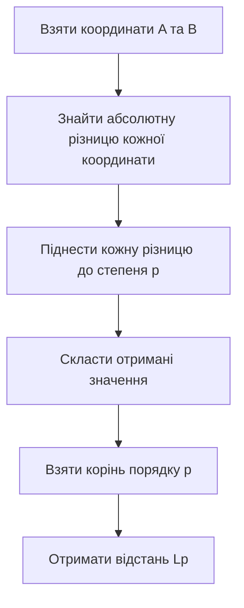
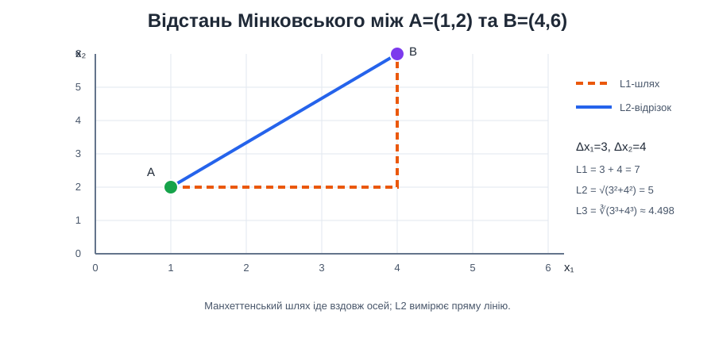

# Приклад 1 — відстань Мінковського вручну

Скрипт [`minkowski_distance.py`](minkowski_distance.py) покроково рахує відстані L1, L2 і L3 між точками `A=(1,2)` та `B=(4,6)`. Він не використовує сторонніх бібліотек: кожен крок формули видно у звичайному Python-лозі.

## Теоретичні відомості

Відстань Мінковського обчислює різницю між відповідними координатами двох точок:

$$
d_p(A,B)=\left(\sum_{j=1}^{d}|A_j-B_j|^p\right)^{1/p}.
$$

Для `p=1` координатні різниці просто додаються; для `p=2` їхні квадрати додаються, після чого береться квадратний корінь; для `p=3` береться кубічний корінь суми кубів модулів. Що більше `p`, то сильніше впливають великі різниці окремих координат.

## Формула

$$
d_p(A,B)=\left(\sum_j |A_j-B_j|^p\right)^{1/p}.
$$

Для цих точок різниці координат дорівнюють `3` і `4`:

| Порядок | Розрахунок | Результат |
|---|---|---:|
| L1 | `3 + 4` | `7` |
| L2 | `√(3² + 4²)` | `5` |
| L3 | `∛(3³ + 4³) = ∛91` | `≈ 4.498` |





## Запуск

Із папки `Practice2`:

```powershell
.\.venv\Scripts\python.exe .\01_minkowski_distance\minkowski_distance.py
```

## Що побачити в логу

Для кожного `p` скрипт показує різницю координат, піднесення до степеня, суму та корінь. Наприклад, для L2 журнал міститиме `3²=9`, `4²=16`, `9+16=25` і `√25=5`.
