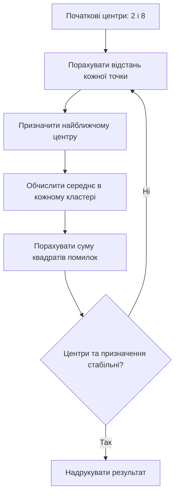
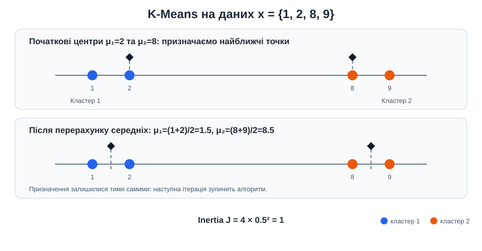

# Приклад 2 — один цикл K-Means вручну

Скрипт [`kmeans_manual_1d.py`](kmeans_manual_1d.py) виконує Lloyd-ітерації без NumPy та scikit-learn. Набір містить чотири числа, тому всі відстані й середні можна перевірити вручну.

## Теоретичні відомості

K-Means — алгоритм кластеризації без учителя: він отримує координати точок, але не отримує їхні справжні класи. Для заданого `K` алгоритм повторює два кроки: призначає кожну точку найближчому центру, потім перераховує центр як середнє координат точок кластера.

Цільова функція, або inertia, — сума квадратів відстаней до центрів:

$$
J=\sum_{k=1}^{K}\sum_{x_i\in C_k}(x_i-\mu_k)^2.
$$

Поточний приклад одновимірний, тому евклідова відстань дорівнює модулю різниці чисел. Початкові центри впливають на проміжні кроки; алгоритм завершується, коли центри та призначення стабілізувалися або спрацював ліміт ітерацій.

## Дані й початкові центри

```text
Точки:             1   2                         8   9
Початкові центри:      μ₁=2                    μ₂=8
```

Для `K=2` перший крок призначає `1,2` до центра `2`, а `8,9` — до центра `8`. Нові центри:

$$
\mu_1=(1+2)/2=1.5,\qquad
\mu_2=(8+9)/2=8.5.
$$

Після оновлення цільова функція дорівнює:

$$
J=(1-1.5)^2+(2-1.5)^2+(8-8.5)^2+(9-8.5)^2=1.
$$





## Запуск

Із папки `Practice2`:

```powershell
.\.venv\Scripts\python.exe .\02_kmeans_manual\kmeans_manual_1d.py
```

## Як читати лог

Для кожної ітерації скрипт окремо друкує:

1. відстані кожної точки до всіх центрів;
2. призначений номер кластера;
3. середнє значення точок кожного кластера;
4. квадрат відхилення кожної точки від нового центра;
5. перевірку, чи стабілізувалися центри й призначення.

Кластери нумеруються з `1` для читабельного логу; сам номер не означає назву класу.
