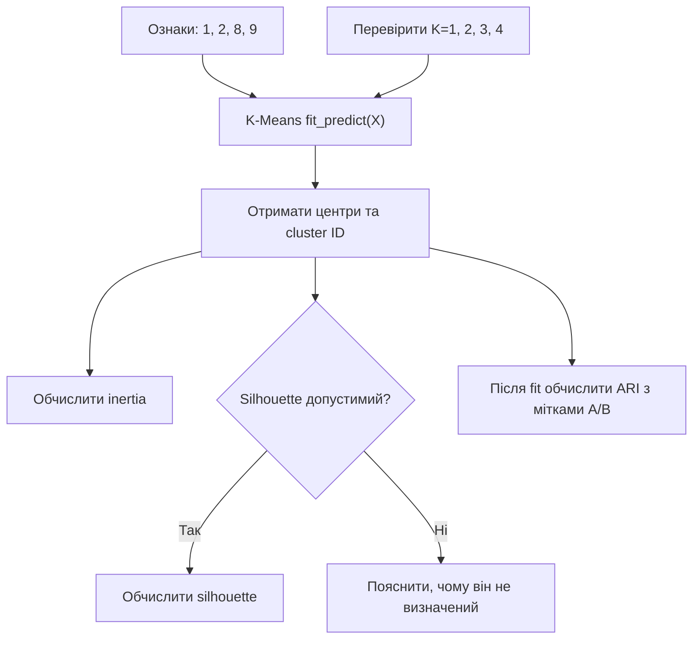
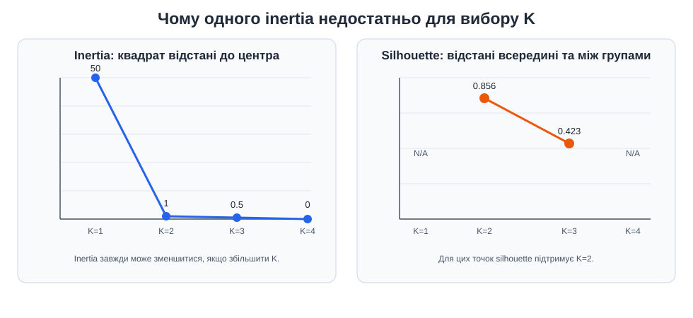

# Приклад 3 — K-Means, silhouette та ARI

[`kmeans_sklearn_metrics.py`](kmeans_sklearn_metrics.py) показує той самий мінінабір `1, 2, 8, 9`, але тепер із `KMeans` зі scikit-learn. Скрипт пробує `K=1,2,3,4`, друкує центри, призначення й відстані, а потім оцінює результат.

## Важлива різниця метрик

- **Inertia** — сума квадратів відстаней до центрів; K-Means мінімізує саме її.
- **Silhouette** — внутрішня оцінка компактності й розділеності; не потребує класів A/B.
- **ARI** — зовнішнє порівняння номерів кластерів зі справжніми мітками. У цьому скрипті `REFERENCE_LABELS` використовується лише після `fit_predict`.

Silhouette не визначений для `K=1` і `K=4` на чотирьох точках: потрібно від 2 до `n_samples-1` кластерів. Номери кластерів можуть змінюватися місцями; ARI цього перейменування не штрафує.

## Теоретичні відомості

**Inertia** — сума квадратів відстаней від кожної точки до центра її кластера. Вона не зростає при збільшенні `K`, тому найменша inertia не обов'язково відповідає найкориснішому групуванню.

**Silhouette** — внутрішня метрика: вона не використовує справжні класи. Для точки `i`, `a(i)` — середня відстань до свого кластера, `b(i)` — найменша середня відстань до іншого кластера:

$$
s(i)=\frac{b(i)-a(i)}{\max(a(i),b(i))}.
$$

Оцінка від `-1` до `1`: ближче до `1` зазвичай означає краще відділення, біля `0` — точку біля межі, від'ємне значення — можливе неправильне призначення.

**ARI** — зовнішня, скоригована на випадковий збіг оцінка узгодженості двох розбиттів. `ARI=1` означає однакові кластери, близьке до `0` — випадкову узгодженість, від'ємне — гіршу за випадкову. ARI не залежить від номерів кластерів, тому його можна обчислити після `fit_predict`, не передаючи мітки в K-Means.





## Запуск

Залежності встановлюються з кореня `Practice2`. Потім:

```powershell
.\.venv\Scripts\python.exe .\03_kmeans_metrics\kmeans_sklearn_metrics.py
```

## На що звернути увагу

Для `K=2` оптимальне групування очікувано поєднує `{1,2}` та `{8,9}`. За `K=4` inertia стає нульовою, бо кожна точка є власним кластером, але це не означає, що такий поділ корисний. Порівнюйте кілька оцінок і пояснюйте їхній зміст.
