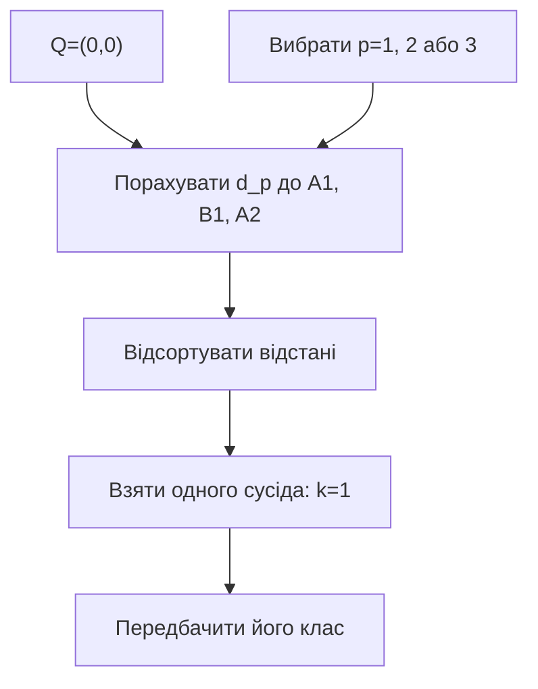
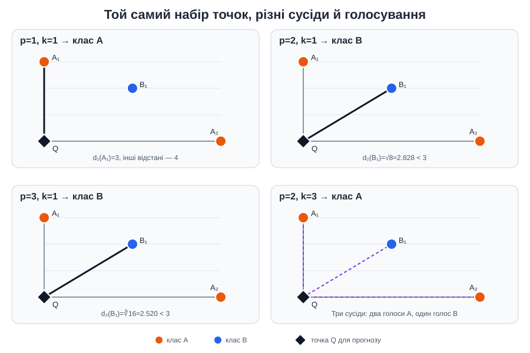

# Приклад 4 — як метрика `p` змінює сусіда

Скрипт [`knn_distance_p.py`](knn_distance_p.py) вручну обчислює L1, L2 і L3 від точки запиту `Q=(0,0)` до трьох розмічених точок.

## Теоретичні відомості

k-NN — алгоритм класифікації з учителем. Для нової точки він вимірює відстань до навчальних прикладів, сортує їх і бере `k` найближчих. За `k=1` прогноз дорівнює мітці одного найближчого прикладу.

Метрика Мінковського має вигляд:

$$
d_p(x,z)=\left(\sum_j|x_j-z_j|^p\right)^{1/p}.
$$

У цьому прикладі `k=1` зафіксовано, щоб окремо побачити вплив `p`: зміна порядку норми може змінити порядок сусідів і, відповідно, прогнозований клас.

Далі використовуються такі точки:

| Точка | Координати | Клас |
|---|---:|---|
| A1 | `(0,3)` | A |
| B1 | `(2,2)` | B |
| A2 | `(4,0)` | A |

```text
x₂
3 | A1
2 |       B1
1 |
0 | Q                       A2
  +--------------------------- x₁
    0   1   2   3   4
```

Для `k=1`:

| Метрика | `d(Q,A1)` | `d(Q,B1)` | `d(Q,A2)` | Найближчий клас |
|---|---:|---:|---:|---|
| L1 | 3 | 4 | 4 | A |
| L2 | 3 | `√8 ≈ 2.828` | 4 | B |
| L3 | 3 | `∛16 ≈ 2.520` | 4 | B |

Скрипт також друкує підсумкову таблицю `p → відстані → найближчий клас`, щоб зміни рангу було легко порівняти одним поглядом.





## Запуск

Із папки `Practice2`:

```powershell
.\.venv\Scripts\python.exe .\04_knn_distance_p\knn_distance_p.py
```

## Що перевірити

Зверніть увагу на `B1`: його Manhattan-відстань дорівнює `4`, але L2 та L3 менші за відстань до `A1`. Тому nearest-neighbor прогноз змінюється, навіть якщо `Q` та навчальні точки не змінювалися.
