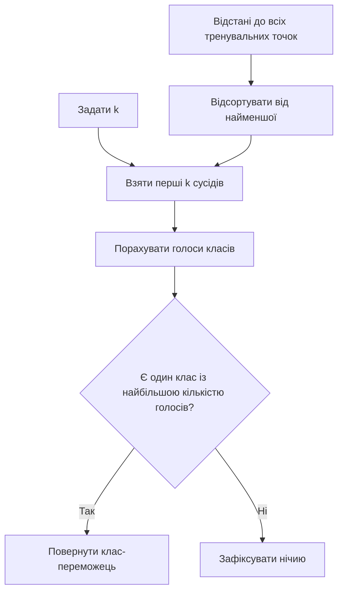
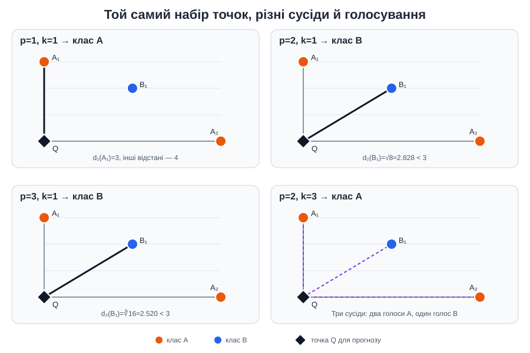

# Приклад 5 — як кількість сусідів `k` змінює голосування

Скрипт [`knn_vote_k.py`](knn_vote_k.py) використовує ті самі три точки з прикладу 4, точку запиту `Q=(0,0)` та евклідову відстань `p=2`. Відстані обчислюються один раз, а потім повторюється голосування для різної кількості сусідів.

## Теоретичні відомості

У k-NN кожен із `k` найближчих навчальних об'єктів віддає голос за свою мітку. Для рівного голосування прогноз — клас із найбільшою кількістю голосів:

$$
\hat y(x)=\arg\max_c\sum_{i\in N_k(x)}\mathbf{1}(y_i=c),
$$

де `N_k(x)` — індекси `k` найближчих прикладів. Малий `k` чутливий до окремих точок; більший `k` згладжує рішення, але може змінити локальну більшість. За однакової кількості голосів виникає нічия, яку в реальному експерименті треба обробляти явно.

| k | Відібрані сусіди | Голоси | Результат |
|---:|---|---|---|
| 1 | B1 | B: 1 | B |
| 2 | B1, A1 | A: 1, B: 1 | Нічия |
| 3 | B1, A1, A2 | A: 2, B: 1 | A |





## Запуск

Із папки `Practice2`:

```powershell
.\.venv\Scripts\python.exe .\05_knn_voting\knn_vote_k.py
```

## Головний висновок

`k` задає кількість голосів, а `p` задає формулу відстані. У цьому скрипті `p=2` зафіксовано, щоб окремо побачити вплив `k`. Нічия при `k=2` є нормальною математичною ситуацією, а не помилкою обчислення.
