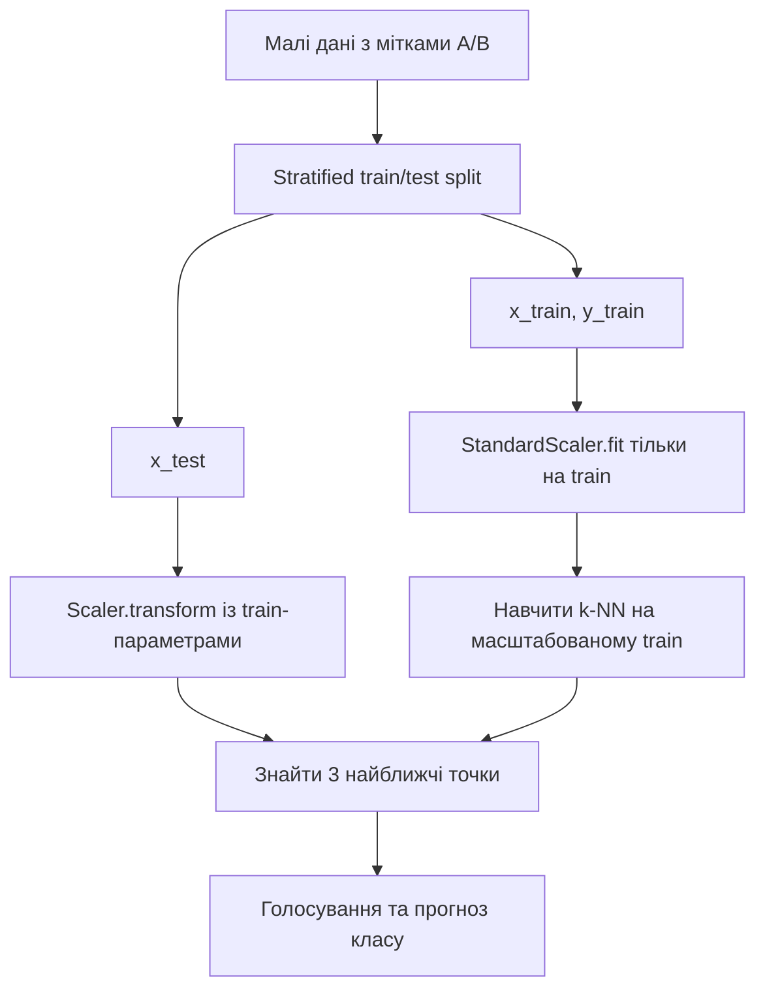
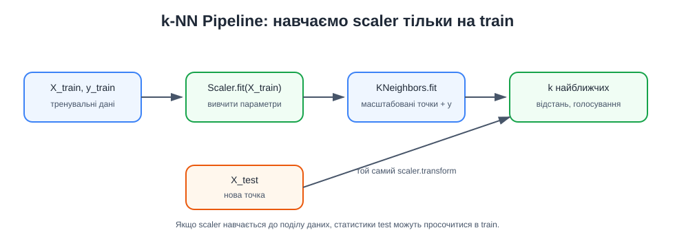

# Приклад 6 — k-NN Pipeline без витоку даних

Скрипт [`knn_pipeline_scaling.py`](knn_pipeline_scaling.py) показує, як поєднати `StandardScaler` і `KNeighborsClassifier` у `Pipeline`. Використовується маленький синтетичний набір із двома числовими ознаками та класами A/B.

`train_test_split` відокремлює тестові точки зі стратифікацією. Pipeline навчає середні та стандартні відхилення тільки на тренувальній частині. До test застосовується вже навчений scaler, а не обчислюються нові параметри.

## Теоретичні відомості

k-NN порівнює точки за відстанню, тому масштаб ознак впливає на те, хто стане сусідом. `StandardScaler` для кожної ознаки віднімає середнє навчальної вибірки та ділить на її стандартне відхилення:

$$
z_j=\frac{x_j-\mu_j}{\sigma_j}.
$$

`Pipeline` навчає scaler і класифікатор послідовно. Якщо спочатку масштабувати всі дані, статистики тестових прикладів вплинуть на навчання — це витік даних. Тому scaler навчається тільки на `train`, а до `test` застосовується та сама вже підігнана трансформація.





## Запуск

Із папки `Practice2`:

```powershell
.\.venv\Scripts\python.exe .\06_knn_pipeline\knn_pipeline_scaling.py
```

## На що звернути увагу в логу

- які рядки потрапили до train та test;
- які `mean_` і `scale_` вивчив `StandardScaler`;
- як виглядає кожна точка до та після масштабування;
- які три тренувальні точки стали сусідами кожної тестової точки;
- як класи сусідів утворюють прогноз.

Малий набір потрібен для читабельного логу. Його accuracy не є доказом якості моделі для інших даних.
