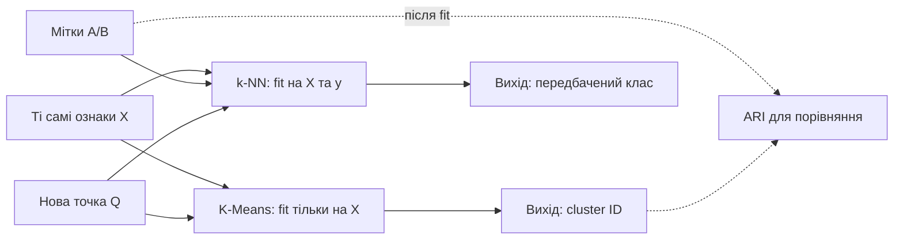
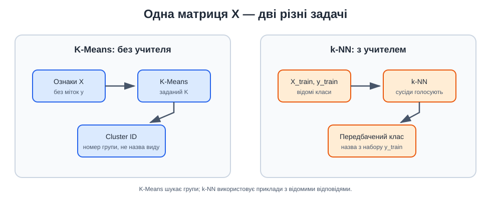

# Приклад 7 — порівняння K-Means і k-NN

Скрипт [`compare_kmeans_knn.py`](compare_kmeans_knn.py) запускає обидва методи на тих самих двох числових ознаках. Вхідний набір має дві компактні групи, позначені A і B для подальшого порівняння.

## Теоретичні відомості

K-Means і k-NN працюють із відстанями, але вирішують різні задачі:

- **K-Means** — навчання без учителя. Він знаходить центри й повертає номер найближчого кластера; мітки A/B не потрібні для `fit`.
- **k-NN** — навчання з учителем. Він зберігає приклади з відомими мітками та передбачає клас нової точки голосуванням сусідів.

K-Means мінімізує суму квадратів відстаней до центроїдів, а k-NN використовує обрані `k` та `p` для пошуку сусідів. Номер кластера не є назвою класу. ARI порівнює їх лише після кластеризації; accuracy для k-NN рахується на відкладеній тестовій частині.

- K-Means навчається тільки на `FEATURES`, повертає номери кластерів і inertia. Мітки A/B використовуються для ARI лише після `fit_predict`.
- k-NN навчається на парах `FEATURES` і `LABELS`, а для тестових точок передбачає клас. `Pipeline` виконує масштабування окремо для тренувального набору.





## Запуск

Із папки `Practice2`:

```powershell
.\.venv\Scripts\python.exe .\07_compare_methods\compare_kmeans_knn.py
```

## Порівняння результатів

Для нової точки K-Means відповідає номером кластера, наприклад `0` або `1`. k-NN повертає одну з відомих міток, наприклад `A` чи `B`. Не можна інтерпретувати номер кластера як назву класу без окремого зіставлення.
