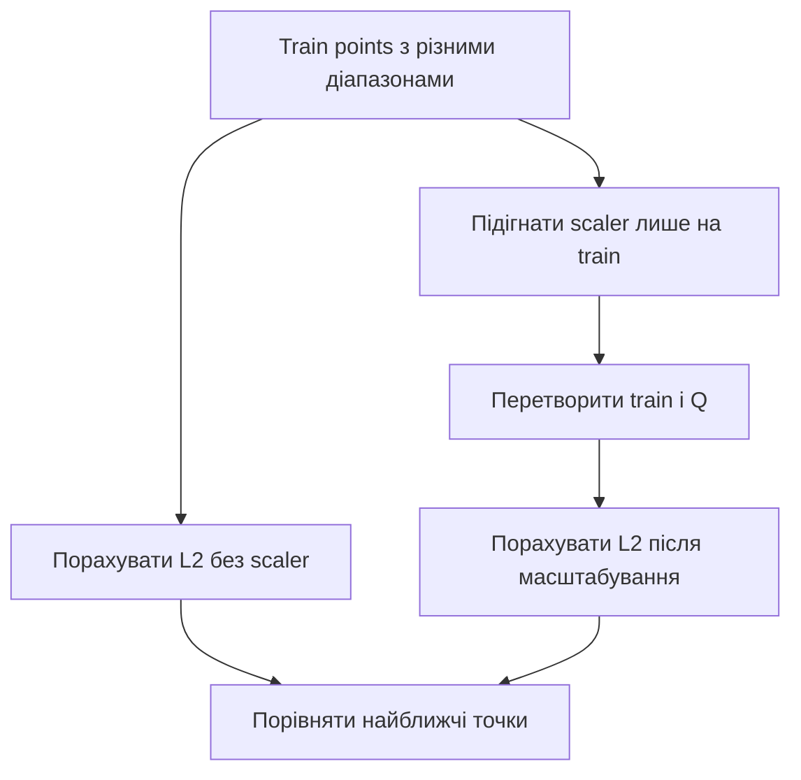
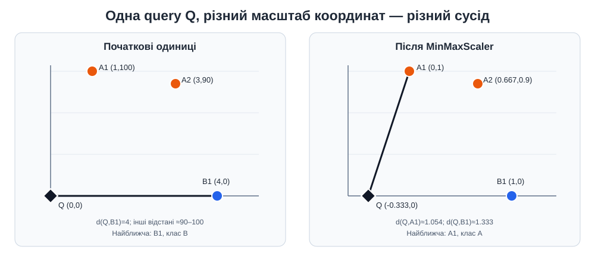

# Приклад 8 — вплив масштабу ознак на k-NN

Скрипт [`knn_scaling_effect.py`](knn_scaling_effect.py) вимірює відстані від `Q=(0,0)` до трьох точок двома ознаками. Перша ознака має діапазон приблизно `1–4`, а друга — `0–100`, тому без масштабування друга координата може домінувати.

## Теоретичні відомості

k-NN визначає сусідів за відстанню. Якщо одиниці вимірювання або діапазони ознак дуже різні, більша за числовим масштабом ознака може визначати результат майже сама.

- `MinMaxScaler` масштабує кожну ознаку за її мінімумом і максимумом навчальних даних.
- `StandardScaler` віднімає середнє та ділить на стандартне відхилення.
- Навчений scaler застосовується до нових точок тим самим перетворенням; не можна повторно `fit` на query чи test.





## Запуск

Із папки `Practice2`:

```powershell
.\.venv\Scripts\python.exe .\08_knn_scaling_effect\knn_scaling_effect.py
```

## Контрольний результат

У цій демонстрації без масштабування nearest neighbor — `B1`, а після MinMaxScaler і StandardScaler — `A1`. Це не означає, що певний scaler завжди кращий: він задає іншу геометрію відстані, яку потрібно обґрунтувати для задачі.
