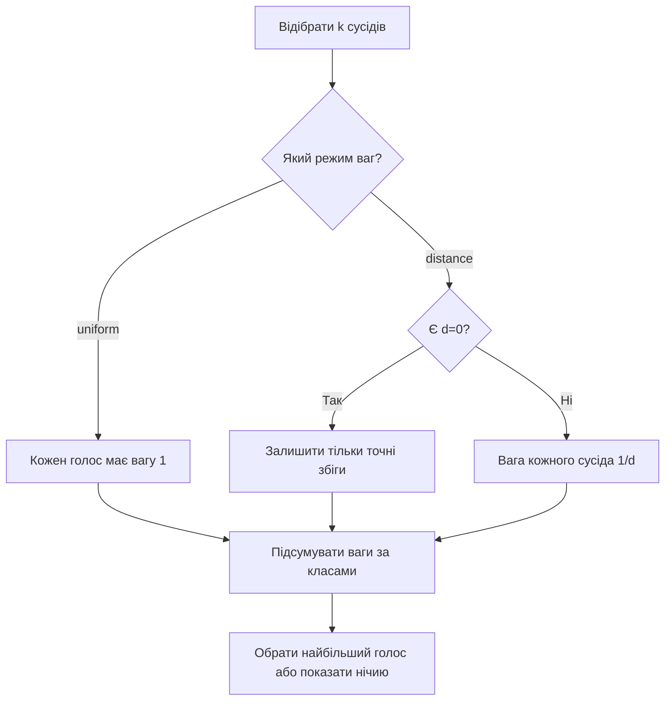
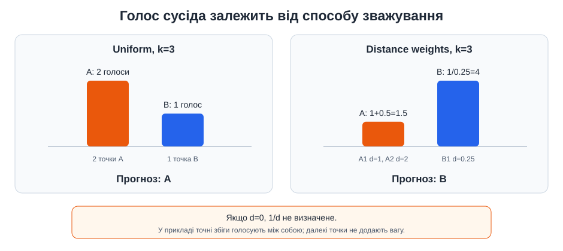

# Приклад 9 — зважене голосування k-NN

[`knn_weighted_vote.py`](knn_weighted_vote.py) порівнює однакові `k` найближчих точок у двох режимах: усі сусіди мають однакову вагу або ближчі сусіди мають більший вплив.

## Теоретичні відомості

Для рівного голосування кожен сусід має вагу `1`. Для зваженого голосування можна задавати вагу, обернену до відстані:

$$
w_i=\frac{1}{d_i}, \qquad
\operatorname{vote}(c)=\sum_{i\in N_k(Q)} w_i\,\mathbf{1}(y_i=c).
$$

Якщо `d_i=0`, формула `1/d_i` не визначена. У прикладі обрано явне правило: коли є точний збіг, голосують лише сусіди з нульовою відстанню; між ними застосовується рівна вага. У scikit-learn аналогічно можна дослідити `weights="distance"`.





## Запуск

```powershell
.\.venv\Scripts\python.exe .\09_knn_weighted_vote\knn_weighted_vote.py
```

## Очікуване спостереження

Для `k=3` рівне голосування дає клас A (два сусіди A проти одного B), а ваги `1/d` — клас B, бо його сусід значно ближчий. У випадку `d=0` скрипт не виконує ділення на нуль і показує застосоване правило.
