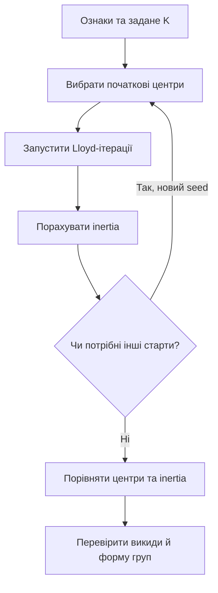
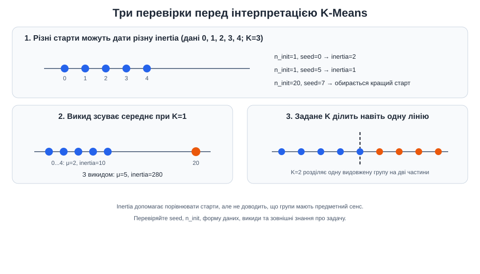

# Приклад 10 — ініціалізація та обмеження K-Means

Скрипт [`kmeans_initialization.py`](kmeans_initialization.py) показує три причини уважно аналізувати результат K-Means: початкові центри можуть привести до різної inertia, середнє чутливе до викидів, а задане `K` примусово ділить дані на K груп.

## Теоретичні відомості

K-Means повторює призначення точок до центрів і перерахунок середніх. Цільова функція — сума квадратів відстаней до центрів:

$$
J=\sum_{k=1}^{K}\sum_{x_i\in C_k}\lVert x_i-\mu_k\rVert_2^2.
$$

Алгоритм може завершитися в локальному мінімумі, тому різні початкові центри здатні дати різні результати. `random_state` робить конкретний запуск відтворюваним, а `n_init` запускає кілька ініціалізацій і вибирає результат із найменшою inertia.

Центроїд є середнім, тому віддалена точка може сильно зсунути його. Крім того, K-Means завжди формує задане `K`: якщо в даних є одна видовжена безперервна група, при `K=2` алгоритм усе одно розріже її на дві частини. Це не автоматично означає, що знайдено дві природні категорії.





## Запуск

```powershell
.\.venv\Scripts\python.exe .\10_kmeans_initialization\kmeans_initialization.py
```

## Що перевірити

- Чи відрізняються inertia для `random_state=0` та `random_state=5` при `n_init=1`?
- Який результат отримує `n_init=20`?
- Як змінюються середнє й inertia після додавання точки `20`?
- Чи є два кластери природним висновком для точок на одній лінії `0...9`?

Конкретні випадкові ініціалізації можуть залежати від версії scikit-learn; порівнюйте значення, виведені вашим запуском.
