# Practice2 — наочні приклади K-Means і k-NN

Ця папка містить невеликі самостійні Python-приклади для ручного розбору відстаней Мінковського, кластеризації K-Means і класифікації k-NN. Усі набори навмисно малі: координати, проміжні відстані, центри та голоси можна перевірити вручну.

Кожен скрипт має власний `README.md` з формулами, інструкціями запуску, очікуваними результатами, Mermaid-схемою та відповідною SVG-ілюстрацією. Коментарі, docstring і журнали виконання написані українською.

## Теоретичні відомості

Набір числових ознак позначатимемо `X`; кожний рядок `x_i` — окрема точка. Відстань Мінковського між двома точками:

$$
d_p(x,z)=\left(\sum_j |x_j-z_j|^p\right)^{1/p}.
$$

`p=1` задає Manhattan-відстань, `p=2` — евклідову, `p=3` — Мінковського третього порядку. Масштаб і одиниці вимірювання ознак впливають на всі відстаневі методи.

**K-Means** — кластеризація без учителя: мітки класів до алгоритму не передаються. Він призначає точки до `K` центрів і мінімізує суму квадратів відстаней:

$$
J=\sum_{k=1}^{K}\sum_{x_i\in C_k}\lVert x_i-\mu_k\rVert_2^2.
$$

**k-NN** — класифікація з учителем: новий об'єкт отримує клас більшості серед `k` найближчих навчальних точок. Параметр `p` змінює міру відстані, а `k` — кількість голосів. `K` у K-Means та `k` у k-NN — різні параметри.

Silhouette та inertia описують геометричну якість кластерів; ARI порівнює кластери зі справжніми мітками лише після кластеризації. Accuracy та macro-F1 оцінюють класифікацію k-NN. Ці метрики відповідають на різні запитання, тому їх не слід напряму порівнювати між алгоритмами. Для k-NN масштабувальник навчається тільки на тренувальній вибірці всередині `Pipeline`.

## Приклади

| № | Скрипт | Що показує |
|---:|---|---|
| 1 | [minkowski_distance.py](01_minkowski_distance/minkowski_distance.py) | Покроковий розрахунок L1, L2 та L3 для двох точок |
| 2 | [kmeans_manual_1d.py](02_kmeans_manual/kmeans_manual_1d.py) | Ручні призначення до кластерів, нові центри та inertia |
| 3 | [kmeans_sklearn_metrics.py](03_kmeans_metrics/kmeans_sklearn_metrics.py) | K-Means із scikit-learn, вибір K, silhouette та ARI |
| 4 | [knn_distance_p.py](04_knn_distance_p/knn_distance_p.py) | Як вибір `p` змінює найближчого сусіда |
| 5 | [knn_vote_k.py](05_knn_voting/knn_vote_k.py) | Як `k=1`, `k=2` і `k=3` змінюють голосування |
| 6 | [knn_pipeline_scaling.py](06_knn_pipeline/knn_pipeline_scaling.py) | Pipeline, навчальне масштабування та тестові прогнози |
| 7 | [compare_kmeans_knn.py](07_compare_methods/compare_kmeans_knn.py) | Порівняння кластеризації без учителя з класифікацією з учителем |
| 8 | [knn_scaling_effect.py](08_knn_scaling_effect/knn_scaling_effect.py) | Як зміна масштабу ознак змінює найближчого сусіда |
| 9 | [knn_weighted_vote.py](09_knn_weighted_vote/knn_weighted_vote.py) | Рівне й зважене голосування, нічия та відстань 0 |
| 10 | [kmeans_initialization.py](10_kmeans_initialization/kmeans_initialization.py) | Вплив seed, `n_init`, викиду та заданого K |

У кожному прикладі є окремий README: [1](01_minkowski_distance/README.md), [2](02_kmeans_manual/README.md), [3](03_kmeans_metrics/README.md), [4](04_knn_distance_p/README.md), [5](05_knn_voting/README.md), [6](06_knn_pipeline/README.md), [7](07_compare_methods/README.md), [8](08_knn_scaling_effect/README.md), [9](09_knn_weighted_vote/README.md) і [10](10_kmeans_initialization/README.md).

## Підготовка та запуск

Потрібен Python 3.10 або новіший. Приклади 1, 2, 4, 5 і 9 використовують лише стандартну бібліотеку Python. Приклади 3, 6, 7, 8 і 10 використовують NumPy та scikit-learn; установіть залежності з папки `Practice2`:

```powershell
py -m venv .venv
.\.venv\Scripts\python.exe -m pip install -r requirements.txt
```

Щоб запускати автоматичні перевірки, установіть також pytest:

```powershell
.\.venv\Scripts\python.exe -m pip install -r requirements-dev.txt
```

Запускайте команди з папки `Practice2`:

```powershell
.\.venv\Scripts\python.exe .\01_minkowski_distance\minkowski_distance.py
.\.venv\Scripts\python.exe .\02_kmeans_manual\kmeans_manual_1d.py
.\.venv\Scripts\python.exe .\03_kmeans_metrics\kmeans_sklearn_metrics.py
.\.venv\Scripts\python.exe .\04_knn_distance_p\knn_distance_p.py
.\.venv\Scripts\python.exe .\05_knn_voting\knn_vote_k.py
.\.venv\Scripts\python.exe .\06_knn_pipeline\knn_pipeline_scaling.py
.\.venv\Scripts\python.exe .\07_compare_methods\compare_kmeans_knn.py
.\.venv\Scripts\python.exe .\08_knn_scaling_effect\knn_scaling_effect.py
.\.venv\Scripts\python.exe .\09_knn_weighted_vote\knn_weighted_vote.py
.\.venv\Scripts\python.exe .\10_kmeans_initialization\kmeans_initialization.py
```

Скрипти використовують фіксовані малі набори й параметри, щоб результат запуску можна було відтворити. Це навчальні демонстрації, а не готові моделі для реальних даних.

## Автоматичні перевірки

Тести перевіряють ручні Lp-розрахунки, центри та inertia, відтворюваність фіксованого seed, перестановку номерів кластерів в ARI, зміну сусідів при масштабуванні, нічию та вагове голосування.

```powershell
.\.venv\Scripts\python.exe -m pytest -v
```

## Як пов'язані приклади

K-Means не отримує мітки класів під час кластеризації. k-NN навчається на точках із відомими класами. Для K-Means ARI обчислюється тільки після того, як кластери вже створені.

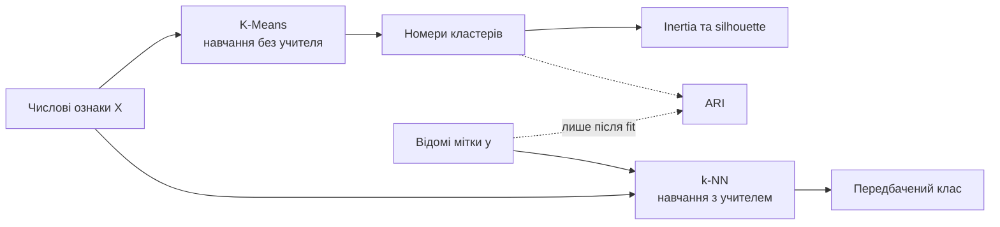

### Цикл K-Means

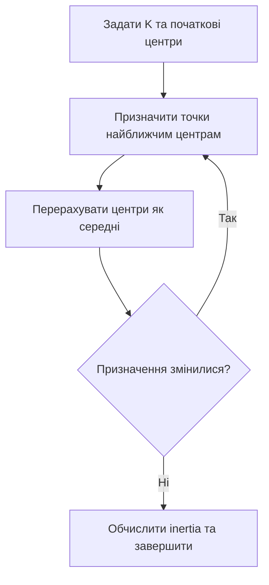

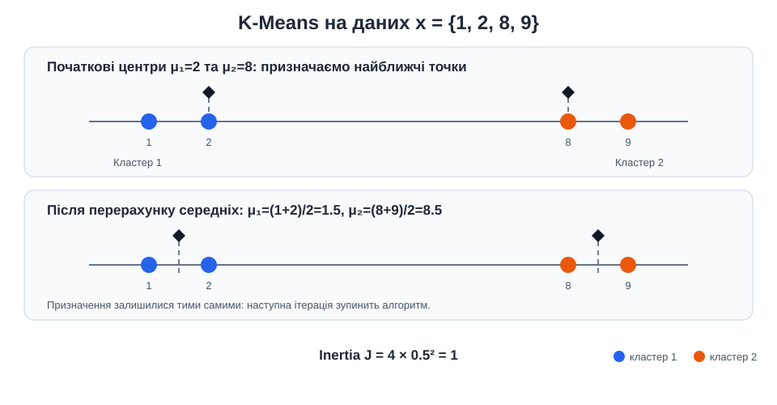

### Голосування k-NN

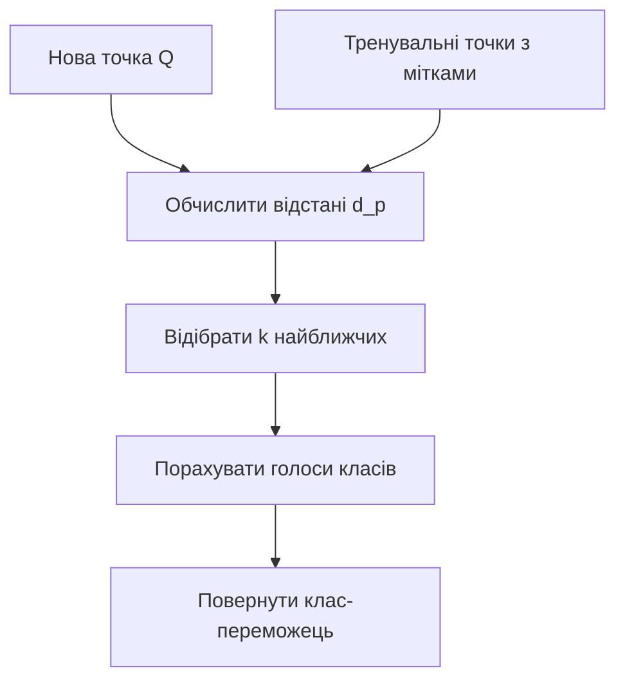

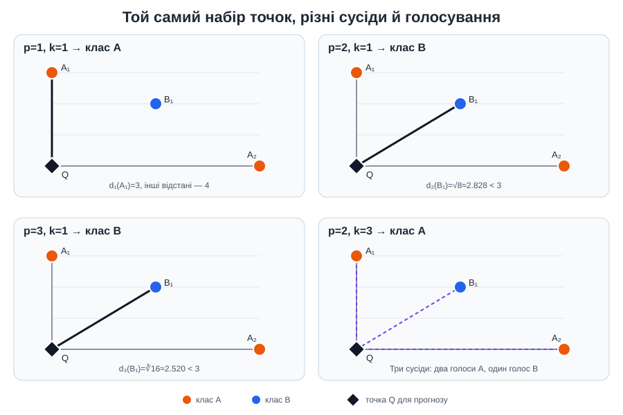

## SVG-ілюстрації

### Відстань Мінковського

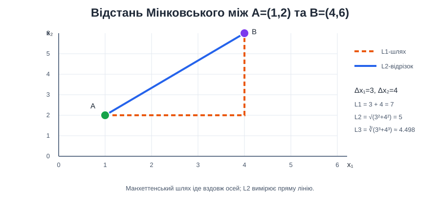

### Inertia, silhouette та вибір K

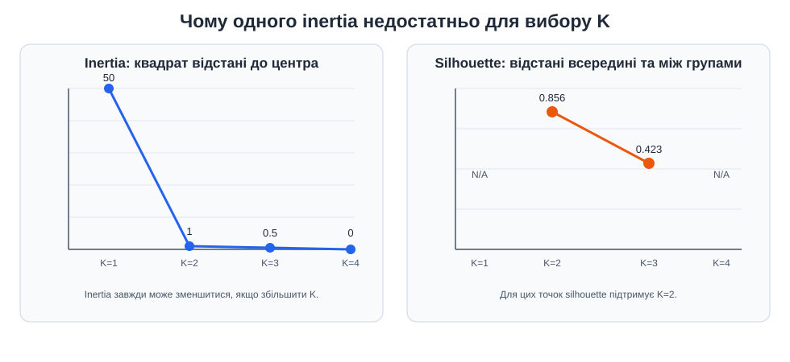

### Pipeline k-NN

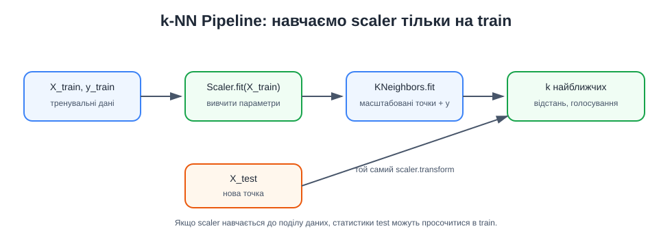

### Дві різні задачі

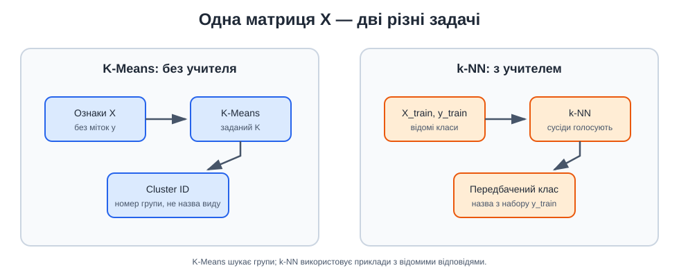

### Масштаб, ваги сусідів та ініціалізація

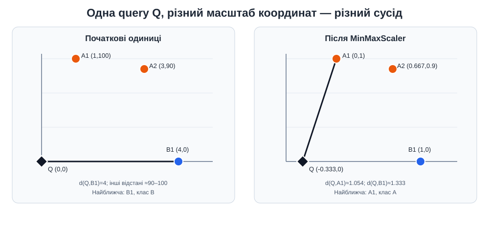

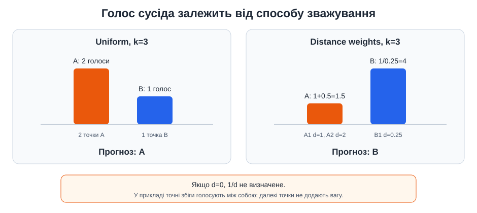

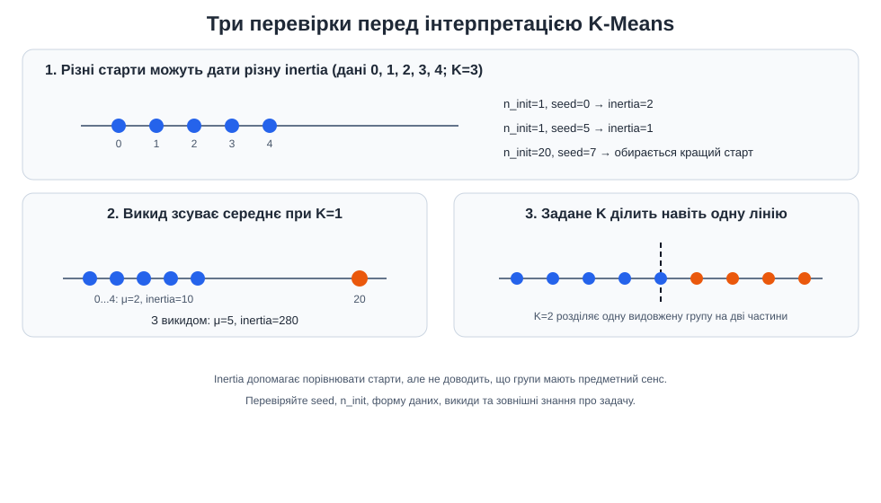
